<p align="center">
  
</p>

<h1 align="center">Octo-Vave</h1>

<p align="center"><i>by Artificial Music</i></p>

<p align="center">
  <b>Every free firmware for the M-VAVE FM-1, in one place: found, ranked, downloaded, checked, and played.</b><br>
  Look for the orange octopus : tested on a real FM-1.
</p>

<p align="center">
  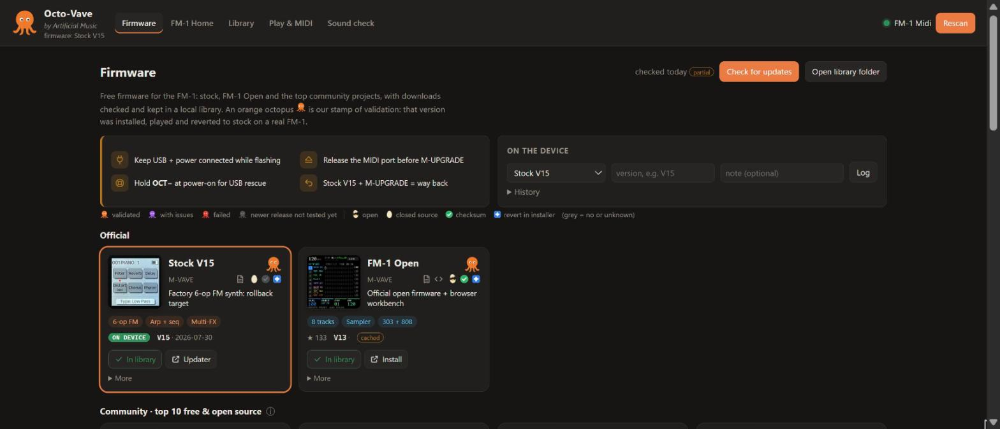
</p>

##  Quick start

1. **Get Python 3.** That's all: Octo-Vave uses the standard library only. Nothing to `pip install`.
2. **Get Octo-Vave.** `git clone` this repository, or use the green **Code** button → **Download ZIP** and unzip it.
3. **Run it.**
   ```
   python server.py        # on Windows you can also double-click start.cmd
   ```
   Your browser opens http://127.0.0.1:8765. Use **Chrome or Edge** (they have Web MIDI with SysEx).
4. **Plug in the FM-1 over USB**, press **Connect** and allow MIDI + SysEx. The FM-1 is picked automatically.
5. You land on the **Firmware** page. Browse the cards, read the tags, and look for the
    orange octopus.

##  What is Octo-Vave?

The FM-1 is a tiny 6-operator FM synth, and its community has turned it into much more: groove
boxes, chord harps, a ReBirth-style 909/808/303, a self-playing ambient garden, a sampler that
records from your phone. Those projects live on different GitHub pages and web installers, each with
its own downloads, checksums and way back to stock.

Octo-Vave gathers them into one local web app:

- **Finds and ranks** every free FM-1 firmware: official, the community top 10 (by GitHub stars and
  downloads), free closed-source projects, and the next 20 under *Also popular*.
- **Tags every card** so you know what you're getting:
  an egg, cracked open for open source or whole for closed source;
  a green check when the release publishes a checksum;
  a blue first-aid cross when the project's installer can put stock firmware back.
- **Downloads into a local library** and verifies each file's SHA256 against what the project publishes.
- **Stamps validated firmware with an orange octopus** 
  after a hands-on session on a real FM-1: installed, played, and reverted to stock.
- **Plays and edits the FM-1** from the browser: a key bed modeled on the device, perform and FX
  controls, a full DX7-style voice editor, a patch library, MIDI tools, and a guided **Sound check**.

Everything runs on your computer: a small Python server on `127.0.0.1` and a page in your browser.
No account, no cloud. Octo-Vave never flashes firmware itself; each project's own installer does that.

##  The orange octopus

 **Orange is the stamp of validation.**
A firmware gets it only after someone has installed it on a real FM-1, played it, run the Sound check,
and reverted to stock V15, with everything working. The colour tells you how it went:

| Octopus | Meaning |
|---|---|
|  orange | Validated cleanly: install, play and revert all worked |
| purple | Validated with issues: it works, with a workaround described in the notes |
| red | Failed validation |
| grey | Validated before, but the project has a newer release that hasn't been tested yet |

Validated so far, all  orange:

| | Firmware | Version | Author |
|---|---|---|---|
|  | Stock V15 | V15 | M-VAVE |
|  | FM-1 Open | V13 | M-VAVE |
|  | Felucca | v1.6.1 | hugelton |
|  | SLOOP | v2.7.1 | 3dSam (isod89) |
|  | ChoralRoot | v0.25.1 | Quixotic7 |
|  | AMB-1 | v1.3 | Charles Vestal |

The live list, with notes from each session, is at the bottom of the Firmware page and in
[`firmware/validated.json`](firmware/validated.json). How a session runs: [VALIDATION.md](VALIDATION.md).

<p align="center">
  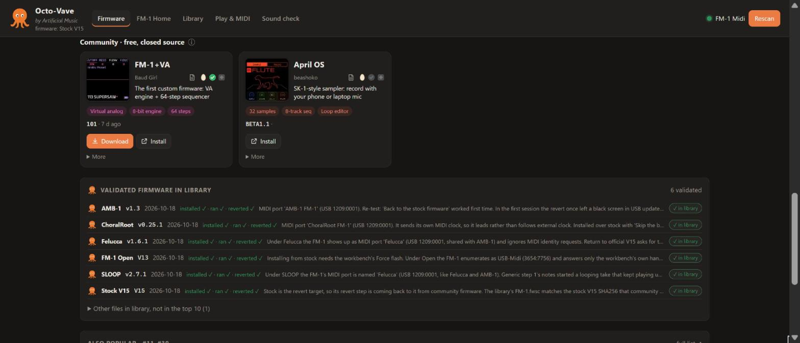
</p>

##  The firmware

The community top 10, ranked by ln(1 + stars) + ln(1 + downloads), with the tags and octopus on each card:

<p align="center">
  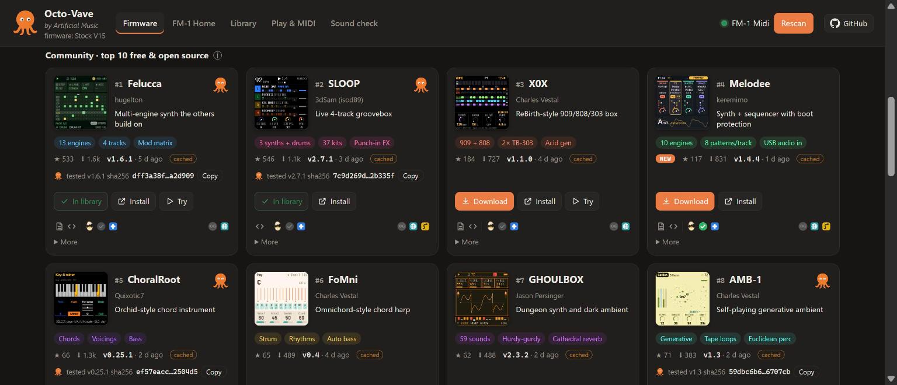
</p>

Up close: screen capture, author, docs and source links, the three tags, and the octopus.

<p align="center">
  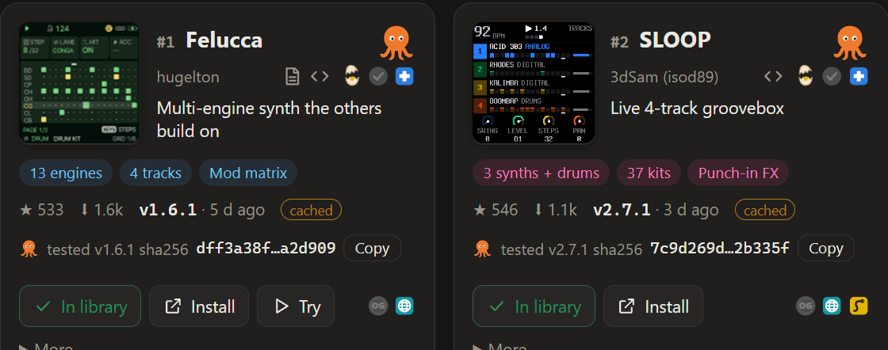
</p>

### Gallery

Screens from each project (images belong to their projects; click through to each one):

<table>
<tr>
<td align="center" width="25%"><a href="https://www.m-vave.com/product?id=fm-1">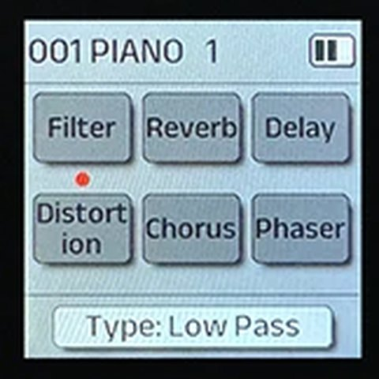</a><br> <b>Stock V15</b><br><sub>M-VAVE · factory 6-op FM, the way back</sub></td>
<td align="center" width="25%"><a href="https://github.com/m-vave/fm1_open">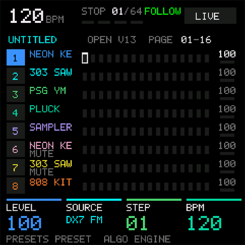</a><br> <b>FM-1 Open</b><br><sub>M-VAVE · official open firmware + workbench</sub></td>
<td align="center" width="25%"><a href="https://github.com/hugelton/Felucca">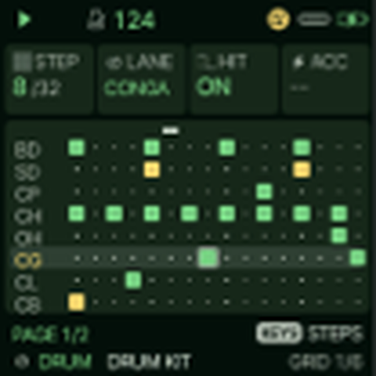</a><br> <b>Felucca</b><br><sub>hugelton · multi-engine synth the others build on</sub></td>
<td align="center" width="25%"><a href="https://github.com/isod89/sloop-fm1">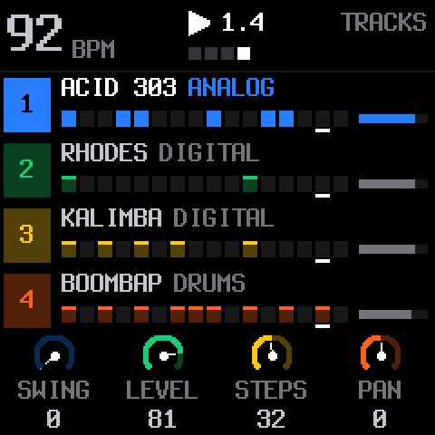</a><br> <b>SLOOP</b><br><sub>3dSam (isod89) · live 4-track groovebox</sub></td>
</tr>
<tr>
<td align="center"><a href="https://github.com/Quixotic7/ChoralRootFM1">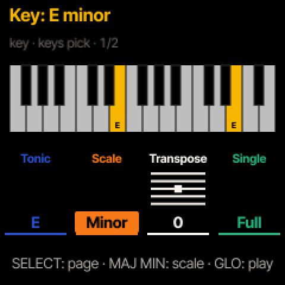</a><br> <b>ChoralRoot</b><br><sub>Quixotic7 · Orchid-style chord instrument</sub></td>
<td align="center"><a href="https://github.com/charlesvestal/fm1-amb">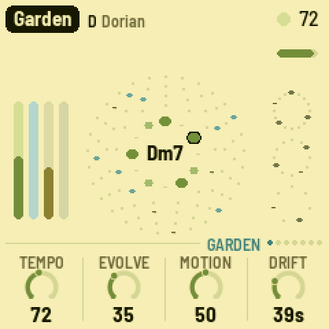</a><br> <b>AMB-1</b><br><sub>Charles Vestal · self-playing generative ambient</sub></td>
<td align="center"><a href="https://github.com/charlesvestal/fm1-x0x">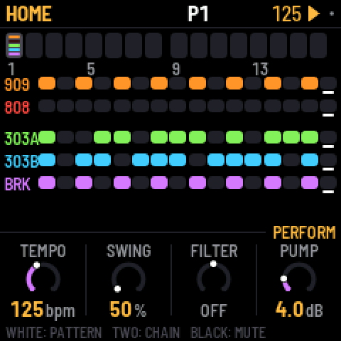</a><br><b>X0X</b><br><sub>Charles Vestal · ReBirth-style 909/808/303 box</sub></td>
<td align="center"><a href="https://github.com/keremimo/melodee">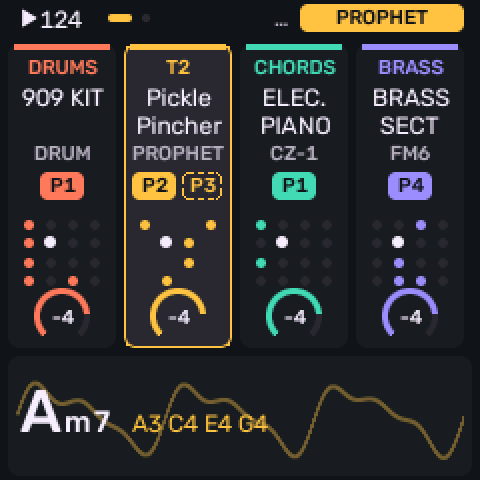</a><br><b>Melodee</b><br><sub>keremimo · synth + sequencer with boot protection</sub></td>
</tr>
<tr>
<td align="center"><a href="https://github.com/charlesvestal/fm1-fomni">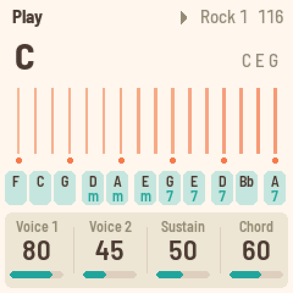</a><br><b>FoMni</b><br><sub>Charles Vestal · Omnichord-style chord harp</sub></td>
<td align="center"><a href="https://github.com/jasonpersinger/ghoulbox-fm1-dungeon-synth">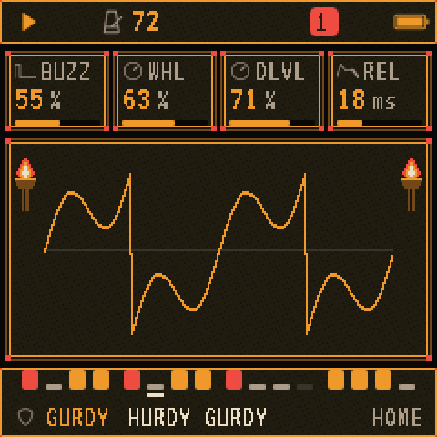</a><br><b>GHOULBOX</b><br><sub>Jason Persinger · dungeon synth and dark ambient</sub></td>
<td align="center"><a href="https://github.com/zednaked/jangada">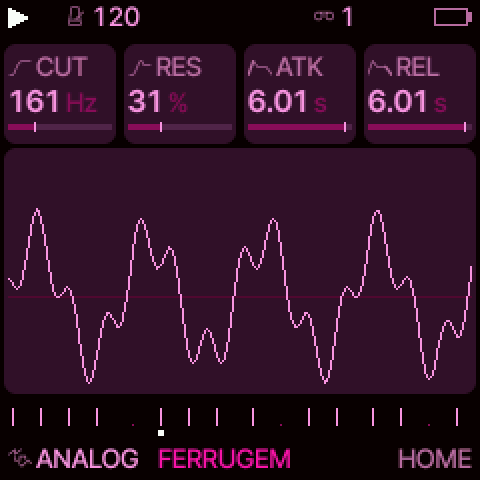</a><br><b>Jangada</b><br><sub>zednaked · superwave analog + mod matrix</sub></td>
<td align="center"><a href="https://github.com/illuminus5/skiff">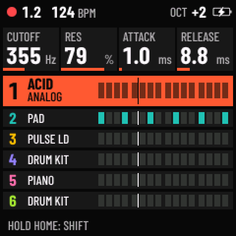</a><br><b>Skiff</b><br><sub>illuminus5 · 6-track groovebox with p-locks</sub></td>
</tr>
<tr>
<td align="center"><a href="https://baudgirl.com/work/FM-1+VA">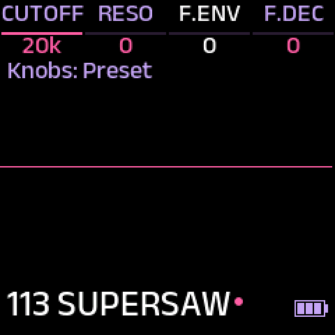</a><br><b>FM-1+VA</b><br><sub>Baud Girl · the first custom firmware: VA engine + 64-step sequencer (free, closed source)</sub></td>
<td align="center"><a href="https://beashoko.github.io/april-os/">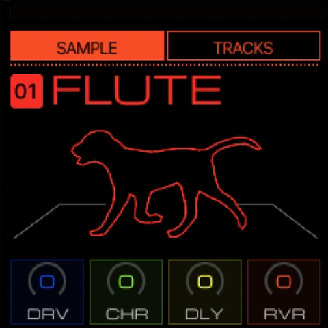</a><br><b>April OS</b><br><sub>beashoko · SK-1-style sampler (free, closed source)</sub></td>
<td></td>
<td></td>
</tr>
</table>

Only free firmware is listed; paid packages never are. The ranking is refreshed with **Check for
updates**, so the top 10 on your screen may differ from this snapshot.

##  Play it too

<p align="center">
  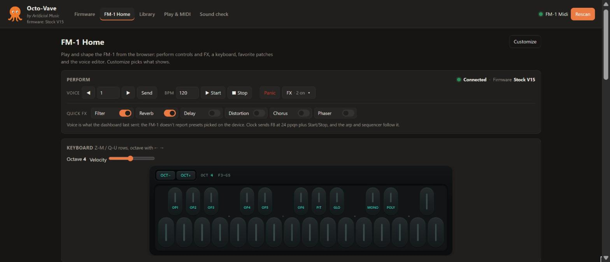
</p>

**FM-1 Home** puts the synth on screen: voice and clock controls, quick FX toggles, a key bed that
mirrors the FM-1's own (play it from your computer keyboard), favorite patches, and a full DX7-style
voice editor whose notes are saved with each patch.

<p align="center">
  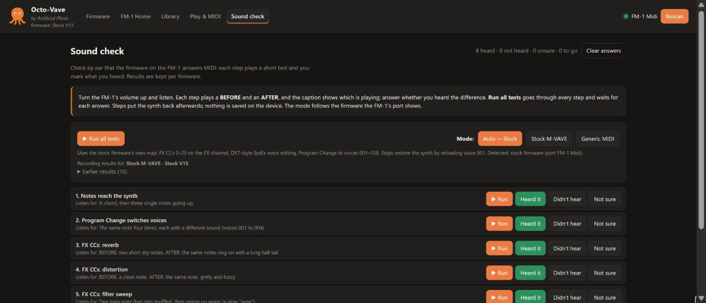
</p>

**Sound check** proves by ear that the firmware on your FM-1 answers MIDI. Each step plays a short
test and you mark what you heard; **Run all tests** walks through them all. The mode follows the
firmware the FM-1 reports, and results are kept per firmware.

##  Tabs in detail

| Tab | What it does |
|---|---|
| Firmware | The exploration hub, and the page the app opens on. An orange octopus is the stamp of validation (see above). **Check for updates** rescans the [awesome-fm-1](https://github.com/cicloid/awesome-fm-1) list and GitHub search and ranks every free, open-source firmware with a `.fwsc` release by ln(1+stars) + ln(1+downloads): top 10 as cards, #11–#30 under **Also popular**. Official cards: Stock V15, FM-1 Open. Curated cards lead with a real screen capture from the project (`web/img/fw/`, credited in `catalog.json`); a project that enters the top 10 without a curated entry gets a card from its GitHub metadata with a placeholder screen and a *not curated yet* marker. Results are cached in `data/discovery-cache.json` with ETags; when the GitHub limit runs out, cards keep their last numbers and the header shows *partial*. `firmware/directory.json` is the offline fallback (`python tools/fm1_discover.py --write` refreshes it). Free closed-source firmware (FM-1+VA, April OS) has no stars or downloads to rank by, so it gets its own curated, unranked section; FM-1+VA's versions and SHA256s are read from its install page, and FM-1 Open's from open.m-vave.com (M-VAVE publishes there before its GitHub mirror, with a SHA256SUMS file per release). Paid firmware is never listed. Each card carries three tags: an egg, cracked open for open source or whole for closed source; a green check when the latest release publishes a checksum; a blue first-aid cross when the project's installer can put stock V15 back (grey = no or unknown, details in the tooltip). Downloads go into `firmware/library/` with SHA256 checks; downloaded files of firmware without a card on screen are listed under *Other files in library*. First installs stay manual, through each project's installer. |
| FM-1 Home | Everything FM-1 on one page. **Perform**: connection and logged firmware, voice program ◀▶, MIDI clock, Panic, and an **FX ▾** pull-down (six FX units, FX channel, Send all, Save to Library). The **FM-1 key bed**: 27 pill keys F–G with the device's OP1–OP6 / PIT / GLO / MONO / POLY labels in black and teal, OCT− / OCT+ (or ← →; at octave 4 it spans F3–G5). **Favorite patches** below the key bed. The **Voice editor**: full DX7-layout SysEx editor (`F0 43 10 pp qq vv F7`), 6 operators, algorithm, feedback, LFO, pitch EG, name, operator on/off, `.syx` import/export, randomize, and **Notes** that are saved with the patch to the Library and come back when it is loaded. **About the FM-1** at the bottom: specs, MIDI implementation, things to try, firmware history, sources. Sections fold up; pick sections, theme and accent under **Customize**. |
| Library | Firmware-aware patches in `data/patches/*.json` (schema v2): each records the firmware it was made for (`firmware: {id, version}`) and a `format`. The list shows both, filters by firmware (default: the one logged on the device), sorts or groups by firmware. Sending a patch made for another firmware asks for confirmation on the card; formats with no known transport can be stored but not sent. Star a patch to pin it on FM-1 Home; ✎ on a row edits its name and hashtags. Older patches load as stock patches and are upgraded when saved. Patches are personal data: `data/` is git-ignored, so they never go into the repository (back them up with Export / JSON or by copying `data/patches/`). |
| Play & MIDI | A generic MIDI I/O utility for any device or firmware: ports, note channel, SysEx spacing, controllers (mod, bend, aftertouch, sustain), Program Change with bank and any CC, a raw hex sender with Identity request, and a classic 3-octave keyboard (computer keys Z–M / Q–U). The **MIDI monitor** uses standard CC and SysEx manufacturer names, filters by type and exports the log as text. **CC discovery** shows each controller's standard name, last value and range; click a row to resend it. |
| Sound check | Guided listening tests with BEFORE/AFTER captions and Heard / Didn't hear / Not sure answers. **Stock M-VAVE** mode (8 steps) tests the stock map: FX CCs, SysEx voice editing, Program Change. **Generic MIDI** mode (11 steps) uses only standard MIDI, for community firmware: channel scan, velocity, sustain, mod wheel, bend, aftertouch, Program Change, clock sync, All Notes Off and a configurable CC probe. **Run all tests** plays every step in turn and waits for each answer. Auto mode follows the MIDI port: "FM-1 Midi" is stock, anything else ("Felucca", "AMB-1 FM-1", "USB-Midi") gets Generic; when the port shows stock but the log says otherwise (after a revert), Stock V15 is logged automatically. A manual mode lasts until the loaded firmware changes. A re-run greys out the earlier answer until a new one is clicked. Results are stored per mode and firmware in `data/settings.json`. |

##  Validating firmware

A firmware card gets an octopus once that firmware has been **installed, run and reverted to
stock V15 on a real FM-1**. If the project then publishes a newer stable release, the octopus stays
but turns grey until that release is retested. Testing happens hands-on, not in the app: follow
[VALIDATION.md](VALIDATION.md) and record the result with
`python tools/fm1_validate.py add … [--result clean|issues|failed]`, which writes
`firmware/validated.json` and pins the tested file's SHA256. The bottom of the Firmware page lists
every tested firmware under **Validated firmware in Library**.

##  Flashing: what Octo-Vave does and doesn't do

Octo-Vave **downloads and organizes** firmware files and links to each project's installer.
It does **not flash** firmware itself. Flash with:

- **Stock / rollback:** M-UPGRADE (download `M-UPGRADE.zip` from the Official card) with `FM-1.fwsc` (V15).
- **Community firmware:** each project's web installer (Chrome/Edge over USB). Melodee and TransitFM1
  add interrupted-write protection; TransitFM1 is meant as a stop between firmwares.

Windows MIDI ports are exclusive. Press **Release MIDI port** (Play & MIDI tab) or close the
Octo-Vave tab before running an installer or M-UPGRADE. USB rescue: hold **OCT−** while switching on.
After flashing, log it under **On the device** so Octo-Vave knows what's running. The Voice
editor and FX on FM-1 Home only target the stock firmware, and a banner warns you otherwise.
Loading validated firmware from the Firmware page is planned.

Flashing firmware is at your own risk. Keep USB and power connected while flashing, and keep the
stock V15 file and M-UPGRADE at hand as the way back.

##  Patch formats

Patch formats live in `firmware/formats/<firmwareId>.json`: how a patch is sent (DX7 SysEx, CC list,
parameters at CC / NRPN / SysEx addresses, raw SysEx, or not yet) and its known parameters, each
marked `confirmed` / `discovered` / `unknown`. Supporting a newly tested firmware is a new file, no
code change; see `firmware/formats/_example.json`. `official.json` describes the stock DX7 voice +
FX patch, and `midi-cc.json` captures CCs, SysEx and a program number for any firmware.
`GET /api/formats` serves the registry.

##  Configuration

- `FM1_PORT`: the local port (default 8765).
- Update checks use the anonymous GitHub API (60 requests/hour). Set `GITHUB_TOKEN`, or
  `FM1_USE_GH=1` to use your GitHub CLI login, for a higher limit.
- Developed and tested on Windows 11 with Chrome.

##  Layout

```
server.py               local server + JSON API (127.0.0.1 only, origin-checked)
start.cmd               Windows launcher
web/                    the app (index.html, app.js, dx7.js, fm1keys.js, style.css, css/<feature>.css)
web/img/fw/             firmware screen captures (credited in catalog.json)
docs/img/               README images and the octopus
firmware/catalog.json   curated firmware cards + discovery settings
firmware/formats/       patch format registry (one file per firmware)
firmware/validated.json validated firmware records (the octopus)
firmware/library/       downloaded firmware files (per id/version, not committed)
data/                   settings, patches, firmware state, discovery/release caches (not committed)
tools/fm1_test.py       interactive command-line MIDI tester
tools/fm1_validate.py   record firmware validations (firmware/validated.json)
tools/fm1_discover.py   run firmware discovery from the command line
```

##  Notes

- The FM-1 doesn't send its current voice back over MIDI, so the voice editor starts from INIT, an
  import or a saved patch, and shows what was last sent. Save on the device to keep edits there.
- The DX7 parameter map comes from the official MIDI guide's SysEx description (0–155). The `.syx` import
  uses the standard DX7 VCED/VMEM formats.

##  Credits

Every firmware here is the work of its authors: M-VAVE, hugelton, 3dSam (isod89), Charles Vestal,
keremimo, Quixotic7, Jason Persinger, zednaked, illuminus5, Baud Girl and beashoko. Screen captures
in `web/img/fw/` come from each project's own pages and remain theirs; the source of each is
listed in [`firmware/catalog.json`](firmware/catalog.json). Firmware files are never included in
this repository: Octo-Vave downloads them from each project. Discovery starts from the community's
[awesome-fm-1](https://github.com/cicloid/awesome-fm-1) list.

Octo-Vave is an independent project, not affiliated with or endorsed by M-VAVE.

##  License

Octo-Vave's own code and docs are released under the [MIT License](LICENSE). The license doesn't
cover the firmware projects or their screen captures in `web/img/fw/`, which stay under their
authors' terms.

<p align="center"><br><sub>Octo-Vave · by Artificial Music</sub></p>
